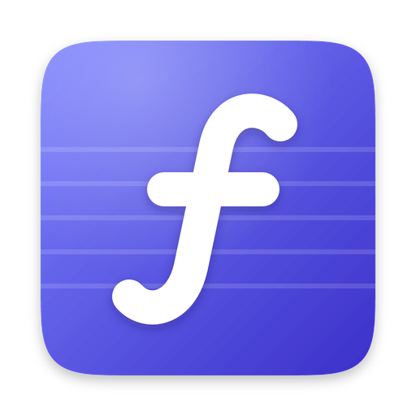

<p align="center"></p>

<h1 align="center">Forte</h1>

<p align="center">Fast, private Markdown notes that are plain files on your computer.</p>

**Forte is free for everyone.** No account, no subscription, no paid tier, and
no ads. It's open source under the [MIT licence](LICENSE).

Your notes are ordinary `.md` files in a folder you choose, so they stay
yours: any editor can open them, and any sync tool can copy them.

## What it does

- **Write in Markdown** with links between notes (`[[Note]]`), `#tags`,
  front matter, math, Mermaid diagrams and coloured code.
- **Find anything** with ⌘K: words in any order, `"phrases"`, `tag:` and
  `in:folder` filters, typo tolerance.
- **See connections:** backlinks under each note, an outline, and a graph.
- **Daily notes and templates**, tabs, focus mode, light and dark themes.
- **Sync your way:** end-to-end encrypted sync through iCloud Drive, Dropbox
  or any synced folder ([how it works](docs/sync.md)), or Git.
- **Optional AI help** with your own Anthropic API key, off by default.
- **Plugins** that run sandboxed ([write one](docs/plugins.md)).

## Download

Installers for macOS, Windows and Linux are on the
[releases page](https://github.com/jmishra01/forte/releases).

## Build from source

You need [Node.js](https://nodejs.org) 20+ and [Rust](https://rustup.rs).
On Linux, also install the
[Tauri prerequisites](https://v2.tauri.app/start/prerequisites/).

```sh
npm install
npm run tauri dev     # run the app
npm test              # frontend tests
cd src-tauri && cargo test
npm run tauri build   # make an installer
```

More: [releasing](docs/releasing.md) · [mobile builds](docs/mobile.md)

## Licence

[MIT](LICENSE): use, change and share Forte freely, including in your own
projects; just keep the copyright notice.
